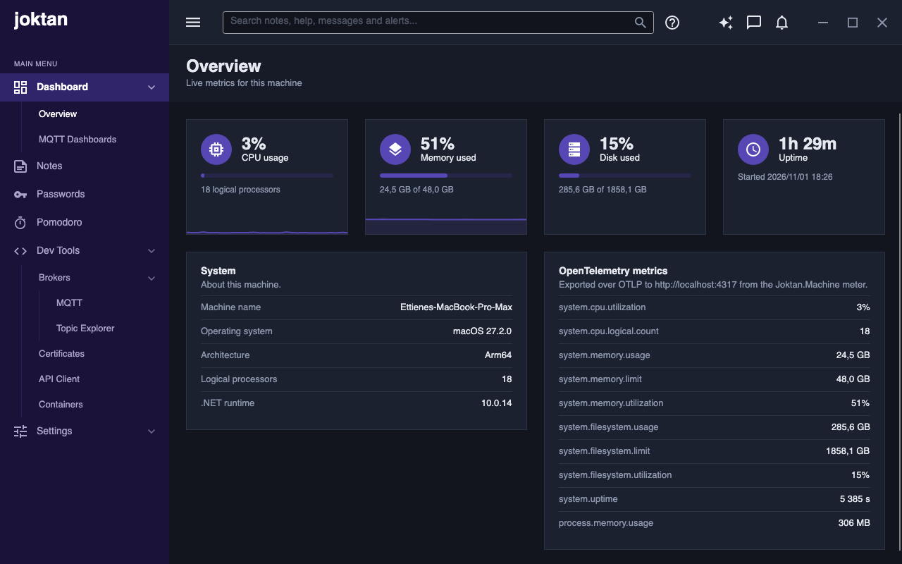
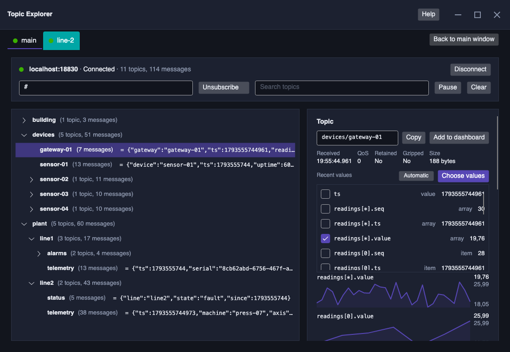

# Joktan

A cross-platform desktop admin application built with [Avalonia UI](https://avaloniaui.net/) and
.NET. It runs on Windows, Linux and macOS from one codebase.



The project is at an early stage. So far it has:

- the application shell and a dashboard of local machine metrics;
- dashboards of your own, with graphs of the numbers on MQTT topics;
- notes written in Markdown, with pages that nest below one another;
- a password manager that keeps logins in folders, in an encrypted vault or the system keychain;
- developer tools: an MQTT publisher for sending test messages, a topic explorer for watching a
  broker, a page for making the certificates they use for TLS, a REST and gRPC client, and a page
  for running compose files with Docker or Podman;
- built-in help on using and configuring each of these: press the question mark beside the search box, or F1;
- settings for which features the menu shows and in what order, and themes that hold every colour,
  font and text size, with Light, Dark and Green Dark built in.

## Requirements

- [.NET 10 SDK](https://dotnet.microsoft.com/download)

## Run

```sh
dotnet run --project src/Joktan
```

To build everything, run `dotnet build` in the repository root, which holds the solution, `Joktan.slnx`.

To run the tests, run `dotnet test` there too. Each assembly in `src/` has its own xUnit project in
`tests/`, laid out like the assembly it tests. They keep to a scratch data folder and never touch your
settings or keychain.

Settings and everything else Joktan keeps go in a `Joktan` folder under the user's application data
folder: `%APPDATA%` on Windows, `~/Library/Application Support` on macOS and `~/.config` on Linux.
Set the `JOKTAN_DATA_DIR` environment variable to keep them in another folder, for example while
testing.

## Tests

Run the test suite from the repository root:

```sh
dotnet test Joktan.slnx
```

To run one project, use `dotnet test tests/Joktan.Api.Tests` (or another test project). Tests use
temporary data folders rather than the application's settings.

Tests of views and controls run in a headless Avalonia application, through `Headless.Run` in
`tests/TestSupport`, so no window opens. MQTT tests use a broker inside the test process, API tests a small
local web server, and container tests stand-in `docker` and `podman` scripts, so nothing outside the machine,
and no broker or container of yours, is touched.

To see code coverage, collect it and turn it into a report at `TestResults/report/index.html`:

```sh
dotnet test --solution Joktan.slnx --coverage --coverage-output-format cobertura --results-directory TestResults
dotnet tool restore
dotnet reportgenerator -reports:"TestResults/*.cobertura.xml" -targetdir:TestResults/report -reporttypes:Html -assemblyfilters:"+Joktan*;-*.Tests" -filefilters:"-*.g.cs"
```

## Publish

Build a self-contained app for a given platform by passing its runtime identifier:

```sh
dotnet publish src/Joktan -c Release -r win-x64 --self-contained -o bin/publish/win-x64
dotnet publish src/Joktan -c Release -r linux-x64 --self-contained -o bin/publish/linux-x64
dotnet publish src/Joktan -c Release -r osx-arm64 --self-contained -o bin/publish/osx-arm64
```

Other identifiers such as `win-arm64`, `linux-arm64` and `osx-x64` work the same way.

## Release

Every commit that reaches `main` gets a version tag: the major and minor numbers from `<Version>` in
`Directory.Build.props`, then the build number, such as `v2.0.17`. To move to a new major or minor
version, change them there.

To build without releasing, start the **Build** workflow on `main` from the Actions tab, or run
`gh workflow run build.yml`. The builds show the tag's version in the About window and on the splash screen.

Releases are published from the fork, [Caracal-IT/Joktan](https://github.com/Caracal-IT/Joktan), and the
original repository refuses to run the workflow. Sync the fork's `main`, open **Release** on the fork's
Actions tab and press **Run workflow**, or run `gh workflow run release.yml --repo Caracal-IT/Joktan`. If
the tests pass on Windows, macOS and Linux, the commit's version is published as a release of the fork with the
builds attached: for Windows, a zip of the single `Joktan.exe` and this README; for macOS, a zipped `.app`; for Linux, a `.tar.gz` of the single `Joktan`
executable and this README, which needs fontconfig (`libfontconfig1` on Debian and Ubuntu). A version can only be
released once, and a commit with no tag of its own gets the next free version. There are no secrets to set up, but Actions must be turned on in the fork, and the
organisation must let workflows have write access.

## Dev tools

**Dev Tools / Brokers / MQTT** sends test messages to MQTT brokers, typed in by hand or read from
a folder of JSON files, on a schedule and with fields that change on every send. Each client has
its own tab, broker, folder and activity log, any number can be connected at once, and each can
use TLS or mutual TLS with certificates from PEM or PFX/P12 files. It is specified
in [docs/features/dev-tools/connectivity/mqtt/spec.md](docs/features/dev-tools/connectivity/mqtt/spec.md).

**Dev Tools / Brokers / Topic Explorer** has a tab per client; each subscribes to that
client's broker and shows every topic as a tree with its latest value, history and a publish
form. It draws a graph of each number that is changing in a topic's JSON, and **Choose values**
picks which to draw: a value, a whole array, or one item of an array. It can be moved into a
window of its own. It is specified in
[docs/features/dev-tools/connectivity/topic-explorer/spec.md](docs/features/dev-tools/connectivity/topic-explorer/spec.md).

**Dev Tools / Certificates** makes certificate authorities, and the server and
client certificates they sign, for brokers and clients using TLS and mutual TLS. Any number of
CAs can be made, each certificate is kept below the CA that signed it, and the subject, key and
expiry date of each can be set, starting from defaults that can be changed. Certificates can be
exported for a broker and picked in a client's settings. It is specified in
[docs/features/dev-tools/connectivity/certificates/spec.md](docs/features/dev-tools/connectivity/certificates/spec.md).

**Dev Tools / Containers** starts, stops, restarts and takes down the services in one or more
compose files, `containers/docker-compose.yml` by default, with Docker or Podman, shows whether each is
running and on which ports, and shows their logs as they are written. It is specified in
[docs/features/dev-tools/containers/spec.md](docs/features/dev-tools/containers/spec.md).

**Dev Tools / API Client** sends REST and gRPC requests and shows the responses. Requests are files
in a folder, so they can live in a project and in version control, and environments fill in
`{{variables}}`, including ones saved from earlier responses. It is specified in
[docs/features/dev-tools/api-client/spec.md](docs/features/dev-tools/api-client/spec.md).



To try them:

1. Start the local brokers with **Start** on Dev Tools / Containers, or with Docker or Podman
   (see [containers/](containers/README.md)):

   ```sh
   docker compose -f containers/docker-compose.yml up -d
   ```

2. In Joktan, open Dev Tools / Brokers / MQTT and connect the `main` client, which points at
   host `localhost`, port `1883`. To try TLS or mutual TLS, make the broker's certificates on
   Dev Tools / Certificates, or use its development ones, as
   [containers/README.md](containers/README.md#tls-and-mutual-tls) describes, and add a client
   for port 8883 or 8884.
3. Press **Choose folder** and pick `samples/mqtt-messages`. Every message starts switched off;
   turn on a message, or a whole group, with the switch in the **On** column.
4. Open Dev Tools / Brokers / Topic Explorer to watch the messages arrive.

## Telemetry

Joktan uses [OpenTelemetry](https://opentelemetry.io/) and exports metrics and traces over OTLP.
By default it sends to a collector at `http://localhost:4317` using gRPC. If nothing is listening
there, the app runs normally and the data is dropped.

The standard environment variables change where it goes:

```sh
OTEL_EXPORTER_OTLP_ENDPOINT=http://localhost:4318 OTEL_EXPORTER_OTLP_PROTOCOL=http/protobuf dotnet run --project src/Joktan
```

Set `OTEL_SDK_DISABLED=true` to turn telemetry off.

The `Joktan.Machine` meter reports the local machine every two seconds. The same readings drive
the dashboard.

| Instrument | Unit | Meaning |
| --- | --- | --- |
| `system.cpu.utilization` | `1` | Share of CPU time in use across all cores |
| `system.cpu.logical.count` | `{cpu}` | Number of logical processors |
| `system.memory.usage` | `By` | Physical memory in use |
| `system.memory.limit` | `By` | Total physical memory |
| `system.memory.utilization` | `1` | Share of physical memory in use |
| `system.filesystem.usage` | `By` | Space in use on the system drive |
| `system.filesystem.limit` | `By` | Capacity of the system drive |
| `system.filesystem.utilization` | `1` | Share of the system drive in use |
| `system.uptime` | `s` | Time since the machine started |
| `process.memory.usage` | `By` | Physical memory used by Joktan |

The filesystem instruments carry a `system.filesystem.mountpoint` attribute. The built-in .NET
`System.Runtime` meter is exported as well, and each page navigation is recorded as a `navigate`
span from the `Joktan` activity source. The MQTT tools add a `Joktan.Mqtt` meter that counts
messages sent, failed, skipped and received, and reports how many clients are connected.

CPU and memory are read from the operating system directly: `GetSystemTimes` and
`GlobalMemoryStatusEx` on Windows, `/proc/stat` and `/proc/meminfo` on Linux, and
`host_statistics` on macOS.

## Project layout

Each page on the main menu is a module with its own assembly. A module keeps its views, view models
and logic together, and the app references the modules and puts them on the menu.

| Path | Contents |
| --- | --- |
| `Joktan.slnx` | The solution |
| `Directory.Build.props`, `Directory.Packages.props` | Settings and package versions shared by every project |
| `.github/workflows/tag.yml` | Tags every commit that reaches `main` with its version, such as `v2.0.17` |
| `.github/workflows/build.yml` | Started by hand: builds, tests and reports coverage, then packages for Windows, macOS and Linux with the version from the tag |
| `.github/workflows/release.yml` | Started by hand: runs the build, then publishes a GitHub release with the builds attached |
| `src/Joktan/` | The app: entry point, shell window, main menu, splash, and `ViewLocator` |
| `src/Joktan.Core/` | What modules share: base view models, styles and colours, icons, shared controls such as the Markdown view, the data folder, the credential store |
| `src/Joktan.Dashboard/` | Dashboard page, machine sampling, OpenTelemetry instruments and SDK setup |
| `src/Joktan.TopicDashboards/` | MQTT Dashboards page: graphs of one or more MQTT topics, the graph editor and its storage |
| `src/Joktan.Notes/` | Notes page and its storage |
| `src/Joktan.Passwords/` | Password manager page and its storage |
| `src/Joktan.Mqtt/` | MQTT page, connection, folder messages, schedules and varying fields |
| `src/Joktan.TopicExplorer/` | Topic Explorer page and window |
| `src/Joktan.Certificates/` | Certificates page; making, keeping and exporting CAs and certificates |
| `src/Joktan.Api/` | API Client page; REST and gRPC requests |
| `src/Joktan.Containers/` | Containers page; running `docker compose` and `podman compose` |
| `src/Joktan.Help/` | Help window, and the help topics as Markdown |
| `packaging/` | App icon source and the macOS bundle icon (see [packaging/](packaging/README.md)) |
| `containers/` | Compose file for local services (two Mosquitto brokers), for Docker and Podman |
| `samples/` | Example MQTT messages |
| `docs/design.md` | Visual design: layout, colours, typography, components |
| `docs/features/` | One folder per feature, each with its specification |

Every module depends on `Joktan.Core`. Beyond that, `Joktan.Mqtt` depends on `Joktan.Certificates`,
`Joktan.TopicDashboards` on `Joktan.Mqtt`, and `Joktan.TopicExplorer` on both.

## Documentation

- [docs/design.md](docs/design.md): layout, colours, typography and components.
- [docs/features/](docs/features/README.md): feature specifications:
  [dashboards](docs/features/dashboards/spec.md),
  [notes](docs/features/notes/spec.md),
  [passwords](docs/features/passwords/spec.md),
  [MQTT publisher](docs/features/dev-tools/connectivity/mqtt/spec.md),
  [topic explorer](docs/features/dev-tools/connectivity/topic-explorer/spec.md),
  [certificates](docs/features/dev-tools/connectivity/certificates/spec.md),
  [API client](docs/features/dev-tools/api-client/spec.md),
  [containers](docs/features/dev-tools/containers/spec.md) and
  [help](docs/features/help/spec.md).

## License

[MIT](LICENSE)
