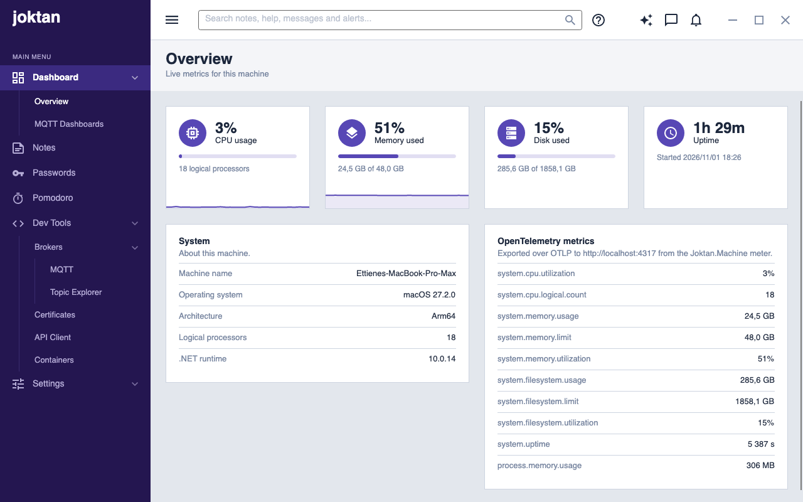

# Joktan design

Joktan uses an admin-dashboard layout: a fixed, dark muted-indigo sidebar on the left, a white top bar,
and a soft grey content area that holds white cards.

The visual reference is [`images/admin-templates.png`](images/admin-templates.png). It is a
screenshot of a third-party template and is used for layout and mood only; Joktan has its own
brand, names and menu.

Current state, showing the dashboard:

| Light | Dark |
| --- | --- |
|  |  |

## App icon

A white lower-case "j" on a rounded indigo tile, shaded from `#6F5BE0` at the top left to the
sidebar colour `#241650` at the bottom right. The vector source is
[`packaging/app-icon/joktan.svg`](../packaging/app-icon/joktan.svg); the files made from it are listed in
[`packaging/README.md`](../packaging/README.md).

The app is named "Joktan" in the macOS menu bar, which has About Joktan and Joktan Help items.

## Layout

```
+-----------+--------------------------------------------+
|           |  Top bar (64)                              |
|  Sidebar  +--------------------------------------------+
|  (240)    |  Page header (title, subtitle)             |
|           +--------------------------------------------+
|           |  Page content (cards, 24 padding)          |
|           |                                            |
+-----------+--------------------------------------------+
```

| Region | Size | Contents |
| --- | --- | --- |
| Sidebar | 240 wide, full height | Brand, "MAIN MENU" caption, navigation |
| Top bar | 64 high | Menu toggle, [search box](features/search/spec.md) with the help icon beside it, [messages and alerts](features/alerts-and-messages/spec.md), then minimise, maximise and close. The window has no system title bar: the top bar is dragged to move the window and double-clicked to maximise it |
| Page header | Auto height, 24 × 20 padding | Page title and subtitle (breadcrumb) |
| Page content | Fills the rest, scrolls | Cards on the app background, 24 outer margin |

The window opens at 1280 × 800 and has a minimum size of 720 × 480. The menu toggle in the top
bar hides and shows the sidebar; the content area takes the freed width.

## Colour

All colours are brushes in [`src/Joktan.Core/Styles/Tokens.axaml`](../src/Joktan.Core/Styles/Tokens.axaml) and are referenced with
`DynamicResource`, never hard-coded in views. By default the app follows the system light/dark setting;
the light variant is the reference design. The tables below are the Light and Dark
[themes](features/settings/spec.md#themes). The chosen theme is laid over these values at run time, and
a new token also goes in `ThemeTokens` so that a theme can set it.

Green Dark is Dark with these changes:

| Token | Green Dark |
| --- | --- |
| `SidebarBackgroundBrush` | `#0F2A1E` |
| `SidebarActiveBrush` | `#1C4A34` |
| `SidebarHoverBrush` | `#163A29` |
| `SidebarDividerBrush` | `#1F4633` |
| `SidebarTextBrush` | `#A9C9B7` |
| `AppBackgroundBrush` | `#0E1512` |
| `SurfaceBrush` | `#17211C` |
| `SurfaceAltBrush` | `#131C18` |
| `BorderBrush` | `#2F4238` |
| `HoverBrush` | `#22302A` |
| `TextBrush` | `#E4EEE8` |
| `TextMutedBrush` | `#8FA89A` |
| `AccentBrush` | `#1E8449` |

### Sidebar

| Token | Light | Dark | Use |
| --- | --- | --- | --- |
| `SidebarBackgroundBrush` | `#241650` | `#1A1238` | Sidebar fill |
| `SidebarActiveBrush` | `#3B2A80` | `#30246A` | Selected top-level item |
| `SidebarHoverBrush` | `#2E1E66` | `#241A4E` | Hovered top-level item |
| `SidebarDividerBrush` | `#392B6E` | `#2B2156` | Rule beside second-level items |
| `SidebarTextBrush` | `#B5ACD6` | `#ACA3CC` | Resting menu text and icons |
| `SidebarTextActiveBrush` | `#FFFFFF` | `#FFFFFF` | Brand, selected and hovered text |

### Surfaces and text

| Token | Light | Dark | Use |
| --- | --- | --- | --- |
| `AppBackgroundBrush` | `#E3E7ED` | `#12151D` | Behind the cards |
| `SurfaceBrush` | `#FFFFFF` | `#1C2130` | Top bar and cards |
| `SurfaceAltBrush` | `#F4F5F8` | `#171B27` | Page header band |
| `BorderBrush` | `#CDD4E0` | `#2C3345` | Card and top bar borders |
| `HoverBrush` | `#EDEFF4` | `#262C3D` | Hovered icon buttons |
| `TextBrush` | `#1C273C` | `#E6E9F0` | Titles and body text |
| `TextMutedBrush` | `#7987A1` | `#8D97AD` | Subtitles, captions, placeholder icons |

### Accent and data colours

These are the same in Light and Dark.

| Token | Value | Use |
| --- | --- | --- |
| `AccentBrush` | `#5747B5` | Active tabs, primary actions. Also set as the Fluent `SystemAccentColor`. |
| `OnAccentBrush` | `#FFFFFF` | Text on the accent colour |
| `SearchMatchBrush` | `#FFD54A` | Behind a word someone [searched for](features/search/spec.md) |
| `OnSearchMatchBrush` | `#1C273C` | A word someone searched for |
| `InfoBrush` | `#0D8BF2` | Data series, informational states |
| `TealBrush` | `#00C4C4` | Data series |
| `PinkBrush` | `#F10075` | Data series |
| `VioletBrush` | `#9B7BF0` | The PATCH method in the API client |
| `SuccessBrush` | `#3BB001` | Positive change badges |
| `WarningBrush` | `#E0920B` | Meter fill from 75% |
| `DangerBrush` | `#DC3545` | Meter fill from 90%, negative change badges, notification dot |
| `AccentTrackBrush`, `WarningTrackBrush`, `DangerTrackBrush` | Fill colour at about 20% opacity | Unfilled part of a meter |

Charts should take their series colours in this order: accent, info, teal, pink.

## Typography

The typeface is Inter, bundled through `Avalonia.Fonts.Inter`, so text looks the same on Windows,
Linux and macOS. A theme can set another for each of the font tokens: `ContentControlThemeFontFamily`
(the interface), `HeadingFontFamily`, `BrandFontFamily`, `MenuFontFamily` and `CodeFontFamily`.

Sizes are tokens too, referenced with `DynamicResource` and never written as numbers in views. These are
the main ones; the rest are in `Tokens.axaml`.

| Role | Token | Size | Weight |
| --- | --- | --- | --- |
| Brand | `BrandFontSize` | 26 | Bold |
| Page title | `PageTitleFontSize` | 24 | SemiBold |
| Body | `ControlContentThemeFontSize` | 14 | Regular |
| Top-level menu item | `MenuFontSize` | 14 | Regular (SemiBold when selected) |
| Second-level menu item | `SubmenuFontSize` | 13 | Regular (Medium when selected) |
| Page subtitle and other secondary text | `SecondaryFontSize` | 13 | Regular |
| Sidebar caption | `SidebarCaptionFontSize` | 10 | Regular, upper case, 0.5 letter spacing |

## Spacing and shape

- Spacing uses a 4-point scale: 4, 8, 12, 16, 20, 24.
- The sidebar has 20 horizontal padding; the content area has 24.
- Cards are square-cornered with a 1-point border and 20 padding, and have no shadow.
- Icon buttons are 36 × 36 with a 4-point corner radius.
- Icons are drawn on a 24 × 24 grid and shown at 18 (menu) or 20 (top bar).

## Components

Styles live in [`src/Joktan.Core/Styles/Shell.axaml`](../src/Joktan.Core/Styles/Shell.axaml), and those for formatted Markdown in
[`src/Joktan.Core/Styles/Markdown.axaml`](../src/Joktan.Core/Styles/Markdown.axaml). Both are applied with style classes.

| Class | Control | Purpose |
| --- | --- | --- |
| `sidebar` | `Border` | Sidebar background |
| `brand` | `TextBlock` | Product name at the top of the sidebar |
| `sidebar-caption` | `TextBlock` | Section caption such as "MAIN MENU" |
| `nav-item` | `Button` | Top-level menu item: icon, title, optional chevron |
| `nav-children` | `Border` | Indented container for the items below a group; nests for the third level |
| `nav-subitem` | `Button` | Second- and third-level menu item |
| `topbar` | `Border` | Top bar surface |
| `icon-button` | `Button` | Borderless icon button in the top bar |
| `window-button` | `Button` | Minimise, maximise and close at the right of the top bar; close turns red on hover |
| `badge` | `Ellipse` | Unread dot over an icon button |
| `page-header` | `Border` | Band holding the page title and subtitle |
| `page-title`, `page-subtitle` | `TextBlock` | Page heading text |
| `card` | `Border` | Content panel |
| `card-title`, `card-subtitle` | `TextBlock` | Heading and description at the top of a card |
| `tile-icon` | `Border` | Round accent badge holding a stat tile's icon |
| `tile-value`, `tile-label`, `tile-detail` | `TextBlock` | Stat tile number, its name, and the supporting line |
| `meter` | `ProgressBar` | Usage bar; add `warning` or `danger` to change its state |
| `info-row`, `info-label`, `info-value` | `Border`, `TextBlock` | Label and value row inside a card |
| `field-label`, `error` | `TextBlock` | Caption above a form field; validation message beneath it |
| `code` | `TextBox`, `TextBlock` | Monospaced text for message bodies and paths |
| `small` | `Button` | Compact button for use inside table rows |
| `state-dot` | `Ellipse` | Status dot; add `ok`, `pending` or `failed` |
| `table-header`, `table-cell`, `table-row` | `TextBlock`, `Border` | Tables built from grids; add `invalid` to a cell for an error |
| `log` | `ListBox` | Bordered, selectable list of log lines |
| `compact` | `ToggleSwitch` | Switch with no On/Off caption, for a table column |
| `group-row`, `group-toggle` | `Border`, `Button` | Header of a group of table rows; the button collapses the group, and takes `collapsed` |
| `client-tabs`, `tab-header` | `TabControl`, `Border` | The tabs of an MQTT client or an MQTT dashboard; a tab's coloured header |
| `tab-button` | `Button` | Added to `icon-button` for a small icon on a tab |
| `swatch` | `Button` | One colour in the palette of a client's settings or a dashboard |
| `console` | `ListBox` | Added to `log` for one close-set line per item, for a container's logs and a command's output |
| `note-title`, `note-editor`, `note-preview` | `TextBox`, `TextBox`, `Border` | A note's title and Markdown while editing, and the formatted page; `note-preview` takes `editing` to be framed beside the editor |
| `method`, `status`, `response` | `TextBlock`, `Border`, `TextBox` | A request's method in the tree, coloured by `get`, `post`, `put`, `patch`, `delete`, `head`, `options` or `grpc`; a response's status, `ok` or `failed`; a response body |
| `node-icon` | `PathIcon` | Small muted folder or key icon beside a name in a tree |
| `md-*` | Inside `MarkdownView` | Headings (`md-h1` to `md-h6`), paragraphs, lists and markers, quotes, code, tables, rules, links and marked text in formatted Markdown |

Menu items add the `selected` class when their view model's `IsSelected` is true.

`MarkdownView` ([`src/Joktan.Core/Controls/MarkdownView.cs`](../src/Joktan.Core/Controls/MarkdownView.cs)) shows Markdown as
formatted text, drawn with the `md-*` classes, and opens links in the browser when clicked, unless
a handler of its `LinkClicked` event takes them, as the help window does for links between topics.

`HelpButton` ([`src/Joktan.Core/Controls/HelpButton.cs`](../src/Joktan.Core/Controls/HelpButton.cs)) is an ordinary button
that opens [help](features/help/spec.md) on the topic its window names, or on the module whose page is shown, whatever its look. It is the icon beside the search box,
whose tooltip names the module, and a button in the header of a settings dialog and the bar of a tool window.

`Sparkline` ([`src/Joktan.Core/Controls/Sparkline.cs`](../src/Joktan.Core/Controls/Sparkline.cs)) is a custom control that draws
a 2-point trend line with a faint fill beneath it, with the newest value at the right edge. The
scale runs from `Minimum` to `Maximum`, which default to 0 and 100.

## Splash screen

While the app starts, a 480 × 300 window with no title bar sits in the middle of the screen, on
top of other windows: the sidebar background and border, the app icon, "joktan" in the brand
style, the version, and at the bottom what is being loaded above a thin indeterminate progress
bar in the sidebar colours. It stays for at least 1.5 seconds, then the main window opens and
the splash closes.

## Tool windows

A tool can run in a window of its own, as the topic explorer and help do. Such a window:

- uses the app background and the same cards and styles as a page, without the sidebar, top bar
  or page header;
- is titled with the tool's name followed by "· Joktan";
- has no owner, so it can sit on another screen or behind the main window;
- closes when the main window closes.

A tool that is also a page, as the topic explorer is, has its content in one control hosted by
both the page and the window, so it looks and behaves the same in either.

## Dashboard

The Overview page shows the state of the local machine and refreshes every two seconds.

- **Stat tiles.** A row of four: CPU usage, memory used, disk used and uptime. Each has an icon,
  the current value at 24 SemiBold, its name, and one supporting line.
- **Meters.** The three usage tiles carry a meter. Its fill is the accent colour, turning to
  warning at 75% and danger at 90%; the track is the same colour at low opacity. The percentage
  is always shown as text, so the state never depends on colour alone.
- **Trends.** CPU and memory show a sparkline of the last 30 samples (one minute) along the
  bottom edge of the tile.
- **Detail cards.** Below the tiles, two cards of label and value rows: facts about the machine,
  and the OpenTelemetry instruments with their latest values.

Data marks use the accent colour only. Values and labels stay in the text colours.

What the dashboard shows and how each value is calculated is specified in
[features/dashboards/spec.md](features/dashboards/spec.md).

## Graphs

MQTT Dashboards draw several numbers at once, so unlike the Overview they need colours to tell them
apart.

- **Colours.** `Chart1Brush` to `Chart8Brush`, with their own steps for each theme. Their order was checked
  for colour blindness against `SurfaceBrush`, so a new number takes the next one rather than a new hue. A
  number keeps its colour when others come and go. Status colours are not used for numbers.
- **Text** stays in the text colours, never the colour of the number. Three of the colours are under 3:1
  on the light surface, so a graph with several numbers always names them, in a legend or under the mark.
- **Marks.** Lines are 2 wide with round joins, with a dot of radius 4 and a ring in the surface colour on
  the latest reading. Areas are the colour at 12%. Bars are at most 24 wide, start from the baseline, and
  have a radius of 4 at the far end only.
- **Grid.** Solid lines 1 wide in `BorderBrush`, with axis text in `GraphAxisFontSize` (11) and `TextMutedBrush`.
- **One scale.** A graph never has a second axis.

## Navigation

- The menu has up to three levels. An entry either opens a page or is a group with children, and
  a second-level entry can itself be a group, as in Dev Tools / Brokers / MQTT.
- Clicking a group expands or collapses it; several groups can be open at once.
- Clicking a leaf selects it and shows its page. Every group above the selected leaf is
  highlighted as well.
- The page subtitle shows the path, for example "Dashboard / Overview".

- An entry can be hidden and moved among its siblings on the [Settings / Menu](features/settings/spec.md) page.

The menu is defined in `MainViewModel`, in `src/Joktan`. Each page with a menu entry is a module with
its own assembly. `MainViewModel.CurrentPage` holds the view model of the page being shown, and
`ViewLocator` resolves it to the view of the same name in the same assembly
(`Joktan.Notes.ViewModels.NotesViewModel` → `Joktan.Notes.Views.NotesView`).

## What is implemented

- The shell: sidebar, top bar and page header.
- The dashboard at Dashboard / Overview.
- MQTT Dashboards at Dashboard / MQTT Dashboards: graphs of MQTT topics, on dashboards laid out as wanted.
- The MQTT publisher at Dev Tools / Brokers / MQTT.
- The topic explorer at Dev Tools / Brokers / Topic Explorer, which can also run in its own
  window.
- Certificates at Dev Tools / Certificates: CAs and the certificates they sign.
- Notes, at Notes: pages of Markdown that nest below one another.
- Passwords, at Passwords: logins in folders, in an encrypted vault file or the system keychain.
- The API client at Dev Tools / API Client: REST and gRPC requests kept as files in a folder.
- Containers at Dev Tools / Containers: compose files run with Docker or Podman.
- [Help](features/help/spec.md), in a tool window opened from the top bar or with F1.
- [Settings](features/settings/spec.md), at Settings: which entries the menu shows and in what order, and themes.

A menu entry with no page of its own opens the placeholder page (`PageView`). No entry does at present.

Not built yet:

- A compact icon-only sidebar
