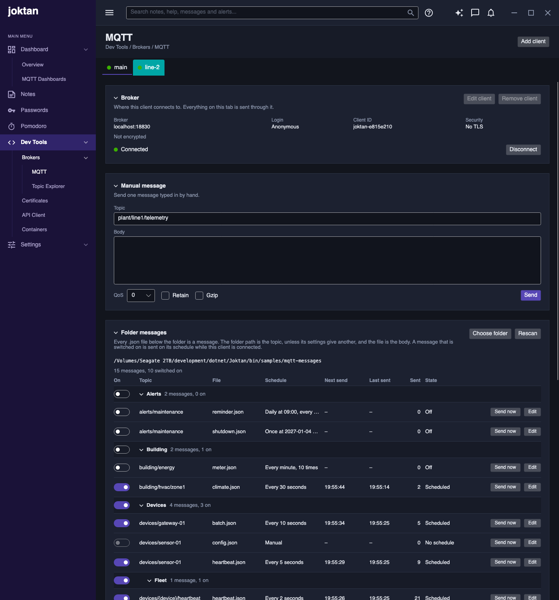

# MQTT publisher

A developer tool for sending test messages to MQTT brokers. It holds any number of clients, each
on a tab of its own with its own broker, folder and activity log, and any number of them can be
connected at once. Messages are either typed in by hand or read from a folder of JSON files, and
folder messages can be sent on a schedule with fields that change on every send.

| Item      | Value                           |
|-----------|---------------------------------|
| Menu path | Dev Tools / Brokers / MQTT |
| Status    | Implemented                     |



## Purpose

Let a developer exercise a system that consumes MQTT messages without writing a script: point
Joktan at a broker, point it at a folder of sample messages, and have them published once or
repeatedly with fresh timestamps and identifiers.

## Page layout

1. Page header: title "MQTT", subtitle "Dev Tools / Brokers / MQTT", and **Add client** on
   the right.
2. A row of tabs, one per client, and one for the [alerts and messages server](../../../alerts-and-messages/spec.md)
   when it is switched on there. Each tab shows the client's name with a dot in the colour of
   its connection state, so every client's state can be seen at a glance; hovering shows its
   host and port.
3. The selected client's tab, from top to bottom:
   1. **Broker** card: the client's broker, login, client ID and security, its connection state,
      and **Edit client** and **Remove client**.
   2. **Manual message** card: send one message typed in by hand.
   3. **Folder messages** card: the client's folder and the messages found in it, in groups,
      each with a switch to turn its schedule on.
   4. **Activity** card: a log of what this client sent and what failed.

Everything on a tab belongs to that client: its manual message, its folder and its activity log.
A message is always sent through the client whose tab it is on.

Each card collapses by clicking its title, and each client remembers which of its cards are
collapsed. Collapsing only changes what is shown: messages switched on keep being sent, and
activity keeps being recorded. A collapsed card keeps its buttons. The **Broker** card also keeps
its connection state, **Connect** or **Disconnect** and any failure, and **Folder messages** keeps
any folder error and its summary.

## Clients

A client is one connection to one broker, with its own login and TLS settings, and its own tab.
Any number of clients can be connected at the same time, to the same broker or to different ones.

### Adding, changing and removing clients

- **Add client** opens the client settings for a new client, filled in with host `localhost`,
  port `1883` and a name such as `client 2`. Saving adds its tab and shows it.
- **Edit client** opens the same settings for the client. It is available only while the client
  is not connected or connecting.
- **Remove client** removes the client and its tab, under the same condition. The last client
  cannot be removed. Its folder and message files are left as they are.
- The first time the app starts there is one client, called `main`, for `localhost` port 1883.
  When upgrading from a version with a single broker, that broker becomes `main`, keeping its
  host, port, username, client ID and saved password, and the folder, manual message and topic
  explorer filters move to its tab.
- The tab that was open last is open again the next time the app starts.

### Client settings

| Setting   | Required | Default                                   | Rules                                                                     |
|-----------|----------|-------------------------------------------|---------------------------------------------------------------------------|
| Name      | Yes      | `client N`                                | Up to 40 letters, digits, spaces, `_`, `-` and `.`; unique, ignoring case |
| Client ID | No       | `joktan-` followed by 8 random characters | No spaces. Left empty, a new one is made when saved                       |
| Host      | Yes      | `localhost`                               | An IPv4 or IPv6 address, or a host name                                   |
| Port      | Yes      | `1883`                                    | A whole number from 1 to 65535                                            |
| Username  | No       | Empty                                     | Sent only when filled in                                                  |
| Password  | No       | Empty                                     | Shown masked; needs a username                                            |

**Save** is enabled once the settings are valid; the reason is shown beside it otherwise.

### Appearance

Each client can have its own colours, so its tab and page can be told apart from the others.

| Setting         | Default | Meaning                                                                         |
|-----------------|---------|---------------------------------------------------------------------------------|
| Tab text        | White   | The colour of the client's name on its tabs                                     |
| Tab fill        | Theme   | The colour the client's tabs are filled with                                    |
| Page background | Theme   | The colour behind the cards on the client's tab                                 |

Each is picked from a palette of 17 colours, typed as `#RRGGBB` (or another form Avalonia
reads, such as `#RGB` or a colour name), or cleared with **Default** to use the theme's. A
colour that cannot be read stops the settings being saved, with "A colour must be like #3BB001,
or empty for the theme's own". Without a text colour the text is white on a tab with a fill;
a tab without a fill keeps the theme's text colour, because white would not show on it. A preview shows the tab and a card on the page.

The colours apply to the client's tab and page here and in the
[topic explorer](../topic-explorer/spec.md), and are saved as `#RRGGBB` with the client.

### TLS and mutual TLS

| Setting                       | Default | Meaning                                                                                                                       |
|-------------------------------|---------|-------------------------------------------------------------------------------------------------------------------------------|
| Use TLS                       | Off     | Encrypt the connection. Switching it on changes port 1883 to 8883, and off changes 8883 back; any other port is left alone    |
| CA certificate                | Empty   | The certificate the broker's must be signed by, as PEM or DER. A PEM file may hold several, such as a root and an intermediate. Empty means the authorities the operating system trusts |
| Accept any broker certificate | Off     | Skip every check of the broker's certificate. The connection is encrypted but the broker is not verified. For testing only   |
| Client certificate            | Empty   | The client's own certificate, for brokers that require one (mutual TLS): a PEM file, or a PFX/P12 file that holds the key too |
| Private key                   | Empty   | The key of a PEM client certificate, as PEM. Empty when the key is in the certificate file. Not shown for a PFX/P12 file     |
| Key password                  | Empty   | Opens a PFX/P12 file or an encrypted PEM key                                                                                 |

Each file has **Browse** and **Clear**. When the [Certificates page](../certificates/spec.md)
has made any, **Or a CA from Certificates** picks one of its CAs, and **Or one from
Certificates** one of its client certificates with its key, and the CA that signed it when no
CA certificate is chosen yet. On **Save** the picked files are copied into the client's own
folder of certificates and the client uses the copies; see
[Use with MQTT](../certificates/spec.md#use-with-mqtt). The lists show what the client's files
were copied from. The files are read while the window is open, so a
problem shows straight away under the TLS settings; it does not stop the settings being saved,
because the file may be fixed before connecting. Once readable, the window shows the CA's name
and the client certificate's name and expiry date.

How the broker's certificate is checked:

- Its host name must match the host entered, unless any certificate is accepted.
- With a CA certificate chosen, it must be signed by that CA, directly or through intermediate
  certificates the broker sends or the CA file holds. Revocation is not checked.
- Without one, it must be trusted by the operating system.

A failed check fails the connection with the reason, for example "The broker's certificate was
refused: it is not signed by the CA certificate".

A client certificate is checked when connecting: it must have its private key and be within its
validity dates. A broker that rejects it ends the TLS handshake, which is reported as "The TLS
handshake failed: …. Check that the broker accepts the client certificate".

The certificate files are read again on every connect, so a renewed certificate takes effect
without restarting. Only their paths are saved.

### Where settings are kept

The client settings are saved when the settings window is saved; what is typed on a tab shortly
after it changes, and again when the app exits.

Everything the page remembers is kept in one file, `mqtt.json`, in a `Joktan` folder under
the user's application data folder: `%APPDATA%` on Windows, `~/Library/Application Support` on
macOS and `~/.config` on Linux, unless [another folder has been chosen](../../../settings/spec.md#changing-the-app-settings-folder).
Setting the `JOKTAN_DATA_DIR` environment variable keeps it in that folder instead.

Passwords are never written to that file. The broker password and the key password are saved
after a successful connection, in the operating system's credential store (see
[Decisions to confirm](#decisions-to-confirm)). The broker password is filed under the username,
host and port; the key password under the full path of the key file, or of the PFX/P12 file. An
empty password removes the saved one.

### Connecting

- **Connect** is enabled when the client's host and port are valid. **Disconnect** replaces it
  while connected, and reads **Cancel** during the first attempt. Disconnecting a client stops
  the scheduled sending of its own folder; other clients carry on.
- A connection attempt that gets no answer within 10 seconds fails.
- If an established connection drops, Joktan tries again every 5 seconds until it succeeds or the
  user presses **Disconnect**.
- Joktan does not connect by itself when the app starts.

### Connection state

The Broker card shows one of these states, as text beside a coloured dot; the tab shows the dot:

| State        | Meaning                                                                                                     |
|--------------|-------------------------------------------------------------------------------------------------------------|
| Disconnected | No connection, and none being attempted (grey)                                                              |
| Connecting   | First attempt in progress (amber)                                                                           |
| Connected    | Ready to send (green)                                                                                       |
| Reconnecting | The connection dropped and is being retried (amber)                                                         |
| Failed       | The last attempt did not succeed (red); the reason is shown below, for example "Not authorized" or "Connection refused" |

## Manual messages

A form for sending a single message:

| Field  | Required | Default | Rules                                                                             |
|--------|----------|---------|-----------------------------------------------------------------------------------|
| Topic  | Yes      | Empty   | A valid publish topic (see [Topic rules](#topic-rules))                           |
| Body   | No       | Empty   | Any text. If it parses as JSON it is shown formatted; it does not have to be JSON |
| QoS    | Yes      | `0`     | 0, 1 or 2                                                                         |
| Retain | Yes      | Off     | On or off                                                                         |
| Gzip   | Yes      | Off     | On or off. When on, the body is compressed with gzip before it is sent            |

- **Send** publishes the message once through the tab's client. It is enabled only while that
  client is connected and the topic is valid.
- The form keeps its contents after sending, so the same message can be sent again.
- Each tab remembers its own topic, body, QoS, retain and gzip between runs.
- Each send appears in the activity log.

## Folder messages

### Choosing the folder

- Each client has a folder of its own. **Choose folder** opens the system folder picker. The
  chosen path is shown in the card and remembered between runs.
- Two clients may use the same folder. Each then sends every message in it; a message's switch
  is kept in its settings file, so switching it on or off on one tab does the same on the other.
- The folder is scanned when it is chosen, when the app starts, and whenever a file in it is
  added, changed, renamed or removed. **Rescan** does the same on demand.
- The folder is read in the background, so the app stays usable while a large folder is read.
  Until the first read finishes the card says "Reading the folder…"; a later read keeps the
  current list on screen until the new one is ready. Only the rows on screen are built, so a
  folder of thousands of messages opens as fast as a small one.
- If the folder no longer exists or cannot be read, the card says so and lists no messages.

### How files become messages

Every `.json` file below the chosen folder is one message, except settings files (see
[Message settings](#message-settings)).

- The **topic** is the path of the folder that holds the file, relative to the chosen folder,
  with `/` between the parts. The file name is not part of the topic. The message's settings can
  give a different topic instead (see [Topic and topic fields](#topic-and-topic-fields)).
- The **body** is the content of the file.
- Several files in one folder are several messages on the same topic.

Example, with `C:\mqtt-samples` as the chosen folder:

```
mqtt-samples/
├── plant/
│   └── line1/
│       ├── telemetry/
│       │   ├── temperature.json        topic: plant/line1/telemetry
│       │   ├── temperature.send.json   settings for temperature.json
│       │   └── pressure.json           topic: plant/line1/telemetry
│       └── status/
│           └── online.json             topic: plant/line1/status
└── readme.json                         invalid: not inside a topic folder, unless its
                                        settings give a topic
```

A file is listed but marked invalid, and never sent, when:

- it sits directly in the chosen folder and its settings give no topic, so it has none;
- its topic is not valid (see [Topic rules](#topic-rules));
- its topic has a `{name}` part with no topic field, or a topic field that the topic does not use;
- it is not valid JSON, or an object in it repeats a key;
- its settings file is not valid, or names a field that is not in the body.

The reason is shown in the message list.

### Topic rules

- Folder names are used exactly as written, including upper and lower case and spaces.
- A topic may not contain `+` or `#`, may not be empty, and may not be longer than 65,535 bytes
  in UTF-8.
- On Windows the path separator `\` becomes `/`.
- A topic field's value is checked on every send. A send whose topic would contain `+` or `#` is
  not made, and is logged as failed.

### Topic and topic fields

The settings file can set the topic itself, in place of the folder path:

```json
{
  "topic": "{folder}/{device}/heartbeat",
  "topicFields": {
    "device": { "type": "cycle", "values": ["sensor-01", "sensor-02", "sensor-03"] }
  }
}
```

- `topic` replaces the folder path. Leave it out, or empty, to use the folder path.
- `{folder}` in it stands for the folder path, so `{folder}/heartbeat` adds a level below it.
- Any other `{name}` is a **topic field**: a part of the topic that gets a new value on every
  send. Each one needs an entry of the same name under `topicFields`, and every entry must be used
  in the topic. Names may use letters, digits, `_`, `-` and `.`.
- Topic fields take the same types as [varying fields](#varying-fields). `cycle` suits them best:
  it goes through the listed values one after the other, so the example above sends to
  `sensor-01`, then `sensor-02`, then `sensor-03`, then `sensor-01` again.
- A text value goes into the topic without its quotes; a number as written. A value containing
  `/` adds levels to the topic.
- A folder name can contain `{name}` too, for example `devices/{device}/heartbeat.json`, without
  setting `topic`; it still needs its entry under `topicFields`.
- A file directly in the chosen folder can be sent once its settings give a topic.
- The message list shows the topic with its `{name}` parts as written. The activity log shows the
  topic each message was actually sent to.

### Message settings

A message is only sent by hand until it has a schedule and is switched on. Settings are edited in the app and stored in a
file beside the message, named after it with `.send.json` in place of `.json`. Keeping them in
the folder means a set of sample messages can be copied or put under version control complete
with its schedules.

`temperature.json`, the body:

```json
{
  "ts": 0,
  "serial": "",
  "sequence": 0,
  "sensor": { "id": "T-100", "value": 21.5 }
}
```

`temperature.send.json`, its settings:

```json
{
  "enabled": true,
  "group": "Plant/Line 1",
  "qos": 1,
  "retain": false,
  "schedule": { "type": "interval", "every": 5, "unit": "seconds" },
  "fields": {
    "ts": { "type": "unixSeconds" },
    "serial": { "type": "guid" },
    "sequence": { "type": "counter", "start": 1, "step": 1 },
    "sensor.value": { "type": "randomNumber", "min": 18, "max": 26, "decimals": 1 }
  }
}
```

| Setting       | Default | Meaning                                                                                                 |
|---------------|---------|---------------------------------------------------------------------------------------------------------|
| `enabled`     | `false` | Whether the message is switched on. This is the switch in the message list                              |
| `group`       | Empty   | The group the message is listed under (see [Groups](#groups))                                           |
| `topic`       | Empty   | The topic to send to instead of the folder path (see [Topic and topic fields](#topic-and-topic-fields)) |
| `topicFields` | None    | Which parts of the topic change on each send (same section)                                             |
| `qos`         | `0`     | 0, 1 or 2                                                                                               |
| `retain`      | `false` | Whether the broker keeps the message for new subscribers                                                |
| `gzip`        | `false` | Whether the body is compressed with gzip before it is sent, after varying fields are applied. Only written when `true` |
| `schedule`    | Manual  | When the message is sent (see [Schedules](#schedules))                                                  |
| `fields`      | None    | Which fields change on each send (see [Varying fields](#varying-fields))                                |
| `arrays`      | None    | How many items arrays are sent with (see [Varying fields](#varying-fields))                             |

### Schedules

Each message has one schedule:

| Type     | Recurring | Settings                                                                                                    | Sent                                                                                   |
|----------|-----------|-------------------------------------------------------------------------------------------------------------|----------------------------------------------------------------------------------------|
| Manual   | No        | None                                                                                                        | Only when the user presses **Send now**                                                |
| Once     | No        | Date and time                                                                                               | One time, at that moment                                                               |
| Interval | Yes       | Every *N* seconds, minutes or hours; optional start and end date and time; optional maximum number of sends | First at the start time, or as soon as the run starts if none is given, then every *N* |
| Daily    | Yes       | One or more times of day; the days of the week it applies to                                                | At each of those times on each of those days                                           |

As stored in the settings file:

```json
{ "type": "manual" }
{ "type": "once", "at": "2026-11-02T08:30:00" }
{ "type": "interval", "every": 5, "unit": "seconds", "start": "2026-11-02T08:00:00", "end": "2026-11-02T17:00:00", "maxSends": 1000 }
{ "type": "daily", "times": ["08:00", "12:30"], "days": ["mon", "tue", "wed", "thu", "fri"] }
```

Rules:

- Dates and times are in the computer's local time zone.
- The shortest interval is 1 second.
- A message is sent on its schedule while two things are true: it is switched on, and its client
  is connected. There is no separate start button.
- Its schedule starts from the moment both become true: when it is switched on while connected,
  or when its client is connected while it is on. Its sent count and counters start again then.
- A message that is switched on while its client is not connected shows "Waiting for connection".
- If the connection is lost and comes back by itself, schedules carry on where they were. A send
  that falls due while the connection is down is skipped and written to the activity log.
- A send that falls due while the message is switched off, its client is disconnected or the app
  is closed is skipped. It is never sent late.
- A "once" message whose time has already passed when its schedule starts is not sent, and is
  shown as "Missed".
- An interval message stops when it reaches its end time or its maximum number of sends, and is
  shown as "Finished". Switching it off and on begins the count again.
- Changing a message's file or settings while it is being sent takes effect from its next send.
- Switches are saved, so a message left on is sent again as soon as its client is connected,
  including after the app is restarted.

### Varying fields

A varying field is a field of the JSON body whose value is replaced each time the message is
sent. Everything else in the body is sent as written.

A field is named by its path from the top of the body: `ts`, `sensor.value`, `readings[0].ts`.
The field must already be present in the body; its value there is only a placeholder.

**Arrays.** `[0]`, `[1]` and so on name one item of an array. `[*]` names every item, so one rule
covers them all:

| Path                 | Changes                                           |
|----------------------|---------------------------------------------------|
| `readings[0].value`  | The `value` of the first reading only             |
| `readings[*].ts`     | The `ts` of every reading                         |
| `readings[*]`        | Every item of `readings` itself                   |
| `lines[*].points[*]` | Every item of every `points` array in `lines`     |
| `[*].ts`             | The `ts` of every item, when the body is an array |

- Each item gets a value of its own: `guid` gives each a different GUID, `randomNumber` a
  different number, and `counter` and `cycle` carry on from one item to the next, so a counter
  starting at 1 gives `1`, `2`, `3` to three items and `4`, `5`, `6` on the next send. Time-based
  types give every item the same instant.
- An item that does not have the field is left alone. The rule is invalid only if it reaches no
  item at all, for example because the array is empty in the file.
- Rules apply in the order they are listed, so `readings[*].value` followed by
  `readings[0].value` gives the first item its own rule and the rest a shared one.
- The field picker in **Edit** offers the `[*]` form of every path inside an array.

**Array sizes.** The settings can also say how many items an array is sent with:

```json
"arrays": {
  "readings": { "min": 3, "max": 6 },
  "lines[*].points": { "count": 10 }
}
```

- `count` sends exactly that many items. `min` and `max` pick a number from one to the other,
  inclusive, on every send.
- The items written in the file are the templates. They are repeated in turn to fill the array,
  so two items filled to five give the first, second, first, second, first. A smaller size keeps
  the first items. A count of 0 sends an empty array.
- The array must be in the file with at least one item, unless its size is always 0. The size
  is at most 10,000.
- `[*]` reaches arrays inside arrays, as in `lines[*].points`. Array sizes are applied in the
  order listed, before the varying fields, so `[*]` field rules reach every item, including the
  added ones.
- **Edit** has an Array sizes card, which offers every array in the body.

| Type               | Settings                                | Value sent                                                    | JSON type | Example                                  |
|--------------------|-----------------------------------------|---------------------------------------------------------------|-----------|------------------------------------------|
| `unixSeconds`      | None                                    | Current time as seconds since 1970-01-01 UTC                  | Number    | `1793606400`                             |
| `unixMilliseconds` | None                                    | Current time as milliseconds since 1970-01-01 UTC             | Number    | `1793606400123`                          |
| `isoTimestamp`     | None                                    | Current time in UTC, ISO 8601                                 | String    | `"2026-11-02T08:00:00.123Z"`             |
| `guid`             | None                                    | A new random GUID                                             | String    | `"3f2b8c1e-9a47-4d1b-8e0a-6c5d2f7b9a10"` |
| `counter`          | `start` (default 1), `step` (default 1) | `start` on the first send, then increased by `step` each send | Number    | `1`, `2`, `3`                            |
| `randomInteger`    | `min`, `max`                            | A whole number from `min` to `max` inclusive                  | Number    | `42`                                     |
| `randomNumber`     | `min`, `max`, `decimals` (default 2)    | A number from `min` to `max`, rounded to `decimals` places    | Number    | `21.5`                                   |
| `oneOf`            | `values`, a list                        | One of the listed values, picked at random                    | As listed | `"open"`                                 |
| `cycle`            | `values`, a list                        | The listed values in turn, starting again after the last      | As listed | `"a"`, `"b"`, `"a"`                      |
| `fixed`            | `value`; optional `values`, a list      | `value` on every send, in place of the body's value           | As given  | `"maintenance"`, `true`, `null`          |

Rules:

- All time-based fields in one message use the same instant, taken at the moment of sending.
- A counter, or the position in a `cycle` list, belongs to one field of one message. It returns
  to the start when the message's schedule starts again.
- A GUID is new on every send. A value that must stay the same across sends is written directly
  in the body instead.
- A `fixed` field overrides the body's value without changing the file. `value` may be any JSON,
  including `null`, and must be present. When `values` is given it lists the allowed values, and
  `value` must be one of them:

  ```json
  "status": { "type": "fixed", "value": "open", "values": ["open", "closed", "fault"] }
  ```

- In **Edit**, "Fixed value" shows a **Type** dropdown (Text, Number, True or false, Null, JSON,
  From a list) that starts as the type of the field's value in the body. Text, Number and JSON
  take a textbox, True or false a switch, Null nothing, and From a list a box for the allowed
  values beside a dropdown to pick one from.
- Varying fields apply to **Send now** as well as to scheduled sends.
- A message with no varying fields and no array sizes is sent exactly as the file is written.
  One with either is sent as compact JSON, without the file's line breaks and indentation.

### Message list

The Folder messages card lists every message found, under its group, sorted by topic and then
file name:

| Column    | Shows                                                                                     |
|-----------|-------------------------------------------------------------------------------------------|
| On        | A switch. On means the message is sent on its schedule while connected                    |
| Topic     | The topic it is sent to, with any `{name}` parts as written                               |
| File      | The file name                                                                             |
| Schedule  | A summary, for example "Every 5 seconds" or "Daily at 08:00, Mon–Fri"                     |
| Next send | When it is next due, or "–"                                                               |
| Last sent | When it was last sent in this session, or "–"                                             |
| Sent      | How many times it has been sent since it was last switched on or its client was connected |
| State     | See below                                                                                 |

The card also shows the totals, for example "13 messages, 3 switched on".

**The switch.**

- Every message starts switched off. A new file, or one with no settings file, is off.
- Turning a switch on or off takes effect at once: the message starts or stops without the folder
  being read again. Its `.send.json` file is then written in the background, created if there
  is none. The folder is not read back after these writes, and a rescan waits until they are
  done, so it never undoes a switch. Joktan waits for them before it closes, for up to 5 seconds
  per client. A file that cannot be written is reported in the activity log.
- Only a message with a schedule can be switched on. For a message with a manual schedule the
  switch is greyed out; give it a schedule with **Edit** first.
- The switch for an invalid message is greyed out.

**State.**

| State                  | Meaning                                                            |
|------------------------|--------------------------------------------------------------------|
| No schedule            | The schedule is manual; the message is only sent with **Send now** |
| Off                    | It has a schedule but is switched off                              |
| Waiting for connection | It is switched on, and will start when its client is connected     |
| Scheduled              | It is being sent; **Next send** shows when                         |
| Finished               | It has reached its end time or maximum number of sends             |
| Missed                 | Its one send time passed before it could be sent                   |
| Invalid                | It cannot be sent; the reason follows                              |

Each row has two actions:

- **Send now** publishes the message once, immediately. It is enabled while connected and the
  message is valid, whether the message is switched on or off.
- **Edit** opens the message's settings: topic, group, switched on, QoS, retain, gzip, topic
  fields, schedule, array sizes and varying fields. It also shows a preview of the topic and body
  with their fields filled in. Saving writes
  the `.send.json` file. It is available whenever the message file is valid JSON; if the existing
  settings file is not valid, the editor starts from the defaults and saving replaces it.

### Groups

Messages can be put into named groups, to keep related ones together and switch them as one.

- A message's group is set in **Edit**, by typing a new name or picking one already in use. It is
  stored as `group` in the message's settings file. Group names ignore case.
- Each group has a header row showing its name and a summary such as "3 messages, 2 on".
- A group can have sub-groups, written with `/` between the levels: `Plant/Line 1` is the group
  "Line 1" inside "Plant". Spaces around the `/` are dropped. A message can sit at any level, so
  `Plant` and `Plant/Line 1` can both hold messages.
- Sub-groups are listed under their parent and indented. Groups at each level are in alphabetical
  order. Messages with no group come last, under "Ungrouped".
- The switch in a group's header turns every message in the group and its sub-groups on or off.
  It only affects messages that have a schedule. It shows on when all of those are on. The
  summary counts the sub-groups' messages too.
- Clicking a group's name collapses or expands it, hiding its sub-groups with it. Collapsed groups
  stay collapsed while the app is running, and their messages carry on being sent.
- A group exists as long as at least one message names it or one of its sub-groups; there is
  nothing to create or delete separately.

## Activity log

Each tab has its own list of that client's most recent 500 events, newest first, kept for the
current session only:

| Column | Shows                                                          |
|--------|----------------------------------------------------------------|
| Time   | Local time, to the second                                      |
| Event  | Sent, Failed, Skipped, Connected, Disconnected or Reconnecting |
| Topic  | The topic, for message events                                  |
| Source | "Manual", or the file name                                     |
| Detail | The size of the body, or the reason for a failure or skip. A gzipped message shows the size sent and the size before zipping, for example "120 bytes gzipped (450 unzipped)" |

Selecting a sent message shows the exact body that was published, before any gzipping. **Clear** empties the log.

## Telemetry

The feature reports to OpenTelemetry through a `Joktan.Mqtt` meter:

| Instrument                     | Kind    | Unit        | Meaning                                                               |
|--------------------------------|---------|-------------|-----------------------------------------------------------------------|
| `joktan.mqtt.messages.sent`    | Counter | `{message}` | Messages published, with a `source` attribute of `manual` or `folder` |
| `joktan.mqtt.messages.failed`  | Counter | `{message}` | Messages the broker did not accept                                    |
| `joktan.mqtt.messages.skipped` | Counter | `{message}` | Scheduled sends skipped because there was no connection               |
| `joktan.mqtt.connected`        | Gauge   | `{client}`  | The number of clients connected to their broker                       |

Topics and message bodies are never included in telemetry.

## Implementation

| Part                           | File                                                                                                                                            |
| ------------------------------ | ----------------------------------------------------------------------------------------------------------------------------------------------- |
| Page and its tabs              | `src/Joktan.Mqtt/Views/MqttView.axaml`, `src/Joktan.Mqtt/ViewModels/MqttViewModel.cs`                                                           |
| One client's tab               | `src/Joktan.Mqtt/Views/MqttClientView.axaml`, `src/Joktan.Mqtt/ViewModels/MqttClientViewModel.cs`                                               |
| Client settings                | `src/Joktan.Mqtt/Views/ClientSettingsWindow.axaml`, `src/Joktan.Mqtt/ViewModels/ClientSettingsViewModel.cs`, `src/Joktan.Mqtt/ClientProfile.cs` |
| Message settings editor        | `src/Joktan.Mqtt/Views/MessageSettingsWindow.axaml`, `src/Joktan.Mqtt/ViewModels/MessageSettingsViewModel.cs`                                   |
| Broker connection and TLS      | `src/Joktan.Mqtt/MqttConnection.cs` (uses the MQTTnet library)                                                                                  |
| Certificate files              | `src/Joktan.Mqtt/CertificateLoader.cs`                                                                                                          |
| Message list rows and groups   | `src/Joktan.Mqtt/ViewModels/FolderMessageRowViewModel.cs`, `src/Joktan.Mqtt/ViewModels/MessageGroupViewModel.cs`                                |
| Folder scanning                | `src/Joktan.Mqtt/FolderScanner.cs`, `src/Joktan.Mqtt/FolderMessage.cs`                                                                          |
| Schedules                      | `src/Joktan.Mqtt/MessageSchedule.cs`, `src/Joktan.Mqtt/FolderPublisher.cs`                                                                      |
| Settings file format           | `src/Joktan.Mqtt/MessageSettings.cs`                                                                                                            |
| Varying fields                 | `src/Joktan.Mqtt/VaryingFields.cs`                                                                                                              |
| Topic fields                   | `src/Joktan.Mqtt/TopicTemplate.cs`                                                                                                              |
| Saved settings                 | `src/Joktan.Mqtt/MqttSettings.cs`, `src/Joktan.Core/CredentialStore.cs`                                                                         |
| Telemetry                      | `src/Joktan.Mqtt/MqttMetrics.cs`                                                                                                                |
| Gzip                           | `src/Joktan.Mqtt/Gzip.cs`                                                                                                                       |

A broker for local testing is in [`containers/`](../../../../../containers/README.md), and a folder
of example messages in [`samples/mqtt-messages`](../../../../../samples/README.md).

Checked on macOS against Mosquitto 2 running under Podman: plain MQTT, TLS with a chosen CA,
and mutual TLS with a PEM certificate and key, a PEM file holding both, an encrypted PEM key and
a PFX/P12 file, with several clients connected at once. The Windows Credential Manager and Linux
Secret Service password stores are implemented but have not been run, and nor has TLS on Windows
or Linux.

## Not included

- Showing received messages; that is the [topic explorer](../topic-explorer/spec.md)
- MQTT over WebSockets
- Certificates from the operating system's certificate store, rather than from files
- Checking whether the broker's certificate has been revoked
- Sending intermediate certificates with the client certificate; the broker must already have
  any intermediate between the client certificate and its CA
- More than one folder for one client; add another client for the same broker instead
- Reordering tabs
- MQTT 5 features such as user properties and message expiry, so a gzipped message carries no
  content-encoding header; receivers recognise it by its first bytes
- Folder messages with a body that is not JSON
- Cron expressions and schedules that depend on other messages
- Catching up on sends that were missed

## Decisions to confirm

These were not stated in the request and are the choices this spec makes. All are implemented as
written:

1. **The file name is not part of the topic.** The topic is the folder path only, as requested;
   two files in one folder publish to the same topic.
2. **Schedules and varying fields live in a `.send.json` file beside each message**, not in the
   app's own settings, so a folder is self-contained. The message file stays a plain body.
3. **The password is kept in the operating system's credential store** (Windows Credential
   Manager, macOS Keychain, the Secret Service on Linux through `secret-tool`). Where none is available it is not
   saved and has to be typed in again each run. It is never written to a settings file.
4. **TLS is per client and off by default**, so a new client suits the local test broker on
   1883. Certificates are read from files, PEM or PFX/P12, rather than from the operating
   system's certificate store, so the same settings work on every platform. Key passwords are
   kept in the credential store like broker passwords.
5. **Missed sends are skipped, not sent late**, so a restart never produces a burst of old
   messages.
6. **Groups are named by the user**, per message, rather than taken from the folder structure,
   so a group can span topics.
7. **There is no Start button.** A message's switch is the only control: on means it is sent
   whenever its client is connected. An earlier version needed Start to be pressed as well, which
   made it easy to believe messages were scheduled when nothing was being sent.
8. **Switches are saved.** A message left on resumes as soon as its client is connected, even
   after a restart. Switch a group off before connecting to a broker you do not want to send to.
9. **Sub-groups are written into the group name** with `/`, like a topic, rather than taken from
   the folders. A parent group needs no message of its own.
10. **Changing parts of a topic are written as `{name}`** and filled in by topic fields, which use
    the same types as varying fields. One send goes to one topic; to reach every
    device at once, use several messages or a short interval with `cycle`.
11. **Each client has a tab, with its own folder, manual message and activity log.** A message is
    sent through the client whose tab it is on, so it is always clear which broker a message goes
    to. An earlier draft kept one folder and named the client in each message's settings, which
    made that hard to see.
12. **A client's settings are edited in a window of their own**, and only while it is
    disconnected, so the settings of a live connection never differ from what is shown.
