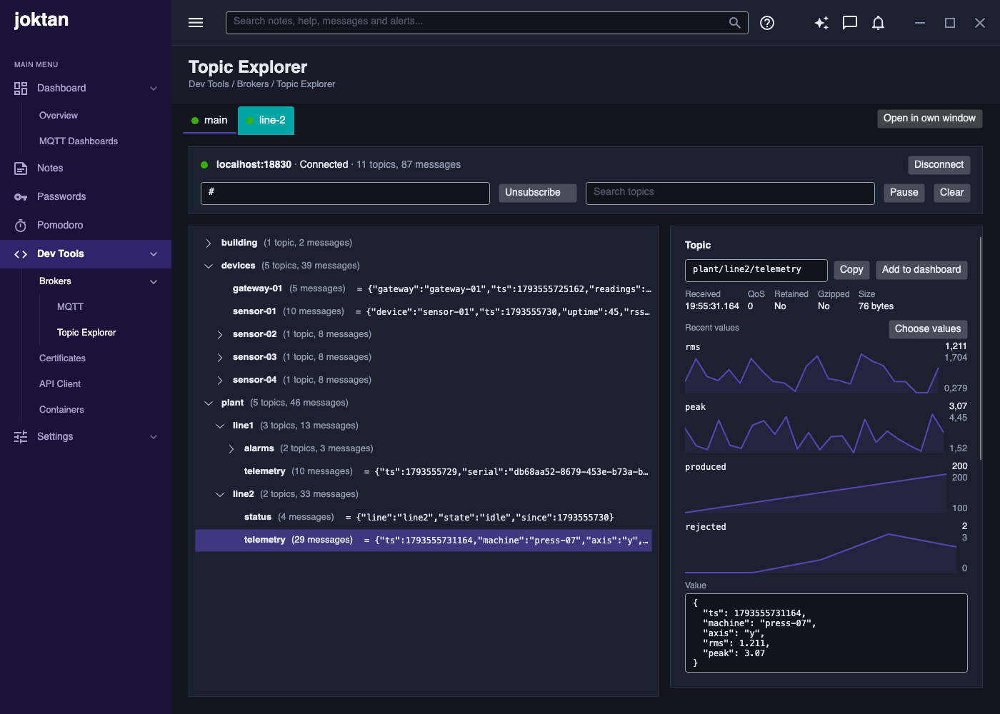

# Topic explorer

A developer tool for seeing what is on MQTT brokers. It has a tab for each client set up on the
[MQTT page](../mqtt/spec.md); each tab subscribes to that client's broker and shows every topic
that carries messages as a tree, with each topic's latest value, and it can run in a
window of its own beside the main one.

| Item      | Value                                     |
|-----------|-------------------------------------------|
| Menu path | Dev Tools / Brokers / Topic Explorer |
| Status    | Implemented                               |

## Purpose

Let a developer watch a broker while working on something else: which topics exist, what was
last published on each, how often, and how a value has moved. It complements the
[MQTT publisher](../mqtt/spec.md), which sends messages; this tool shows what arrives.

## Tabs and connections

The explorer has one tab per client, in the same order as on the MQTT page. A tab is added or
removed when a client is added or removed there. Each tab name has a dot in the colour of the
client's connection state, and each tab and its page take the colours set for the client on
the MQTT page (see [Appearance](../mqtt/spec.md#appearance)).

Every tab is independent: it has its own filters, tree, search, pause, selection, history and
publish form, and keeps receiving while another tab is shown. **Open in own window**, beside the
tabs, moves the whole explorer, with all its tabs, into a window of its own.

Each tab uses its client's connection. The broker, login and certificates are set on the MQTT
page, and connecting or disconnecting in either place affects both.

- The tab's toolbar shows the client's host and port, its connection state and a **Connect** or
  **Disconnect** button.
- **Connect** is disabled until the client has a valid host and port.
- The explorer starts listening, on every tab, the first time it is shown. Until then it
  receives nothing, so a session that never opens it does no extra work.

## Subscriptions

- The filter box holds one or more topic filters, separated by commas. The default is `#`, which
  matches every topic except the broker's own `$SYS` topics. Add `$SYS/#` to see those.
- **Subscribe** replaces the tab's subscriptions with the ones in the box. Filters that were
  accepted are remembered for each client for the next time the app starts.
- While the tab is subscribed to the filters in the box, the button reads **Unsubscribe**, which
  drops every subscription of the tab; topics already in the tree stay. Editing the box turns the
  button back into **Subscribe**, to apply the new filters.
- A tab is subscribed when it first opens, unless it was left unsubscribed; that choice is
  remembered for each client too.
- A filter may use `+` for one whole level and `#` for the whole last level. Anything else is
  reported under the toolbar and nothing changes.
- Subscriptions are made at QoS 2, so each message arrives at the QoS it was published with.
- They are made again automatically after a reconnect.
- Narrowing the filters stops new messages for the topics no longer matched. Topics already in
  the tree stay there until **Clear**.

The connection also carries the subscriptions of [MQTT Dashboards](../../../dashboards/spec.md#mqtt-dashboards),
so each part keeps its own filters and neither replaces the other's:

- The tree only takes in messages its own filters match. A topic only a dashboard subscribes to does not
  appear, and **Unsubscribe** here does not stop a graph.
- A filter another one already covers is not subscribed to, as a broker may send a message once for
  each filter it matches; Mosquitto 2 does.
- A filter that was covered already brings no retained values by itself, so it is subscribed to for a
  moment to ask the broker for them. The tree can then show such a value a second time.

## Topic tree

Each level of a topic, split at `/`, is a node. `site/line1/temperature` is the node
`temperature` under `line1` under `site`.

Each node shows:

| Part                  | Shown when                                                     | Example                   |
|-----------------------|----------------------------------------------------------------|---------------------------|
| Level name            | Always                                                         | `line1`                   |
| What is below it      | It has topics below it                                         | `(2 topics, 24 messages)` |
| Its own message count | It has received more than one message and has nothing below it | `(12 messages)`           |
| Latest value          | It has received a message                                      | `= 21.5`                  |

Rules:

- Children are sorted by name, ignoring case.
- A node can have a value of its own and children as well.
- An empty level, as in `a//b`, is shown as "(empty level)".
- The latest value is shown on one line, cut off after 120 characters or at the edge of the tree,
  which does not scroll sideways. Hovering shows those 120 characters, and selecting the topic
  shows it all.
- A payload that is not valid UTF-8 text is shown as its size and its first 256 bytes in hex.
- A gzipped payload is unzipped and shown as its content, with "gzip" beside the value. MQTT has
  no header for this, so a payload is taken to be gzipped when it starts with the gzip bytes
  `1F 8B` and unzips cleanly. One that does not unzip, or would unzip to more than 16 MB, is shown
  as received.
- New topics are added collapsed.
- The tree is updated about seven times a second, however fast messages arrive.

The toolbar shows the totals, for example "7 topics, 40 messages".

### Search

Typing in the search box hides every node whose full topic does not contain the text, ignoring
case. A node stays visible if anything below it matches, and is opened so the match can be seen.
Topics that arrive while a search is active follow the same rule. Clearing the box shows
everything again.

### Pause and clear

- **Pause** stops the tree changing. Messages that arrive while paused are discarded, not queued.
- **Clear** empties the tree and resets the totals. It does not unsubscribe.

## Selected topic

Selecting a node shows it on the right.

**Topic.** The full topic, with a **Copy** button that puts it on the clipboard. For a topic that carries
numbers, **Add to dashboard** opens the [graph editor](../../../dashboards/spec.md#graph-editor), starting with
the numbers being drawn and the messages in the history. It can make a new graph or add the topic to one
already on a dashboard. Once saved, a line below says where it went.

**Latest message**, for a node that has received one:

| Field    | Shows                                                                 |
|----------|-----------------------------------------------------------------------|
| Received | Local time to the millisecond                                         |
| QoS      | 0, 1 or 2                                                             |
| Retained | Yes when the broker sent it as the topic's stored value, otherwise No |
| Gzipped  | Yes when the payload arrived gzipped, otherwise No                    |
| Size     | The payload size in bytes; for a gzipped one, also the unzipped size  |
| Value    | The payload, unzipped if it was gzipped. JSON is indented; anything else is shown as received |

**Recent values**, above the value. A line for each number on the topic that is changing, showing its last 60
values, scaled between the smallest and largest of them, with those two values labelled beside it.

- A payload that is one number has one line. In a JSON payload each number has its own, named by
  its path, as for [varying fields](../mqtt/spec.md#varying-fields), with its latest value beside
  the name, for example `sensor.value`. They are in the order the latest message has them.
- The items of an array share a line, named with `[*]`, such as `readings[*].value` or `samples[*]`.
  Their values follow one another in the order they arrive, so a batch of readings carries on from
  the one before it.
- A number needs two different values among the last 100 messages to get a line, so one that stays
  the same has none. Text, true or false, and numbers written as text have none either.
- Timestamps have none, as a line that only climbs says nothing: Unix seconds or milliseconds from
  about 2001 on, that never go down.
- At most 12 lines are shown, and a note says how many more there are. Payloads over 1 MB are not
  looked into.

**Choose values**, beside the title, opens a list of every number in the payload, so what is drawn
can be chosen, with each number's latest value and what kind it is:

| Kind  | Example             | What its line draws                                               |
|-------|---------------------|-------------------------------------------------------------------|
| value | `sensor.value`      | That number, message after message                                |
| array | `readings[*].value` | Every item of the array, as described above                       |
| item  | `readings[0].value` | That one position of the array, message after message. The first 20 positions of an array are listed |

Ticking or clearing a number means only what is ticked is drawn from then on, including a number
that does not change, a timestamp or one position of an array. **Automatic** goes back to drawing
whatever is changing, as above. The choice is kept for each topic of each client, between runs,
and stays after **Clear**.

**History.** The last 100 messages on the topic, newest first, each with its time, "gzip" if it
arrived gzipped, and the start of its value. Selecting one shows it in the fields above in place
of the latest; selecting another topic returns to the latest.

A node that only groups other topics says so and shows no message.

## Publishing

A form below the selected topic sends a message:

| Field  | Default            | Rules                                           |
|--------|--------------------|-------------------------------------------------|
| Topic  | The selected topic | A valid publish topic: not empty, no `+` or `#` |
| Body   | Empty              | Any text                                        |
| QoS    | `0`                | 0, 1 or 2                                       |
| Retain | Off                | On or off                                       |
| Gzip   | Off                | On or off. When on, the body is gzipped before it is sent |

- **Publish** is enabled while connected and the topic is valid. The result is shown under the
  form: when and where it was sent, or why it was not.
- **Clear retained value** removes the selected topic's stored value from the broker, by
  publishing an empty retained message to it. It is enabled when the selected topic's latest
  message was a retained one.

## Own window

- **Open in own window** moves the explorer into a separate window. The page in the main window
  then says so and offers **Back to main window**.
- The window is independent of the main one: it can go on another screen, behind the main
  window, or be resized freely. The rest of the app stays usable.
- Like the main window, it has no system title bar. A bar across the top, titled "Topic
  Explorer", moves the window when dragged and maximises it on a double-click, and has
  minimise, maximise and close buttons on the right.
- The tree, selection, filters and search carry over in both directions; nothing is lost by
  moving.
- Closing the window, or pressing **Back to main window** in either place, returns the explorer
  to the page.
- Closing the main window closes the explorer window and exits the app.
- Only one explorer window can be open.

## Telemetry

The explorer adds one instrument to the `Joktan.Mqtt` meter:

| Instrument                      | Kind    | Unit        | Meaning                    |
|---------------------------------|---------|-------------|----------------------------|
| `joktan.mqtt.messages.received` | Counter | `{message}` | Messages added to the tree |

Messages published from the explorer are counted in `joktan.mqtt.messages.sent` with
`source` = `manual`. Topics and message bodies are never included in telemetry.

## Limits

- 100 messages of history are kept per topic, and the recent values come from them. The number of topics is not
  limited, so a broker with a very large number of topics will use memory accordingly.
- Nothing that was received is kept between runs.

## Implementation

| Part               | File                                                                                                                         |
| ------------------ | ---------------------------------------------------------------------------------------------------------------------------- |
| Page               | `src/Joktan.TopicExplorer/Views/TopicExplorerView.axaml`, `src/Joktan.TopicExplorer/ViewModels/TopicExplorerViewModel.cs`    |
| Explorer content   | `src/Joktan.TopicExplorer/Views/TopicExplorerPanel.axaml`                                                                    |
| Own window         | `src/Joktan.TopicExplorer/Views/TopicExplorerWindow.axaml`                                                                   |
| Tree node          | `src/Joktan.TopicExplorer/ViewModels/TopicNodeViewModel.cs`                                                                  |
| Received message   | `src/Joktan.Mqtt/ReceivedMessage.cs`                                                                                         |
| Subscriptions      | `src/Joktan.Mqtt/MqttConnection.cs`                                                                                          |
| One client's tab   | `src/Joktan.TopicExplorer/Views/ClientExplorerPanel.axaml`, `src/Joktan.TopicExplorer/ViewModels/ClientExplorerViewModel.cs` |
| Filter rules       | `src/Joktan.Mqtt/TopicRules.cs`                                                                                              |
| Recent values      | `src/Joktan.TopicExplorer/ViewModels/FieldTrendViewModel.cs`, `src/Joktan.Mqtt/JsonNumbers.cs`                               |
| Trend line         | `src/Joktan.Core/Controls/Sparkline.cs`                                                                                      |
| Add to dashboard   | `src/Joktan.TopicExplorer/Views/ClientExplorerPanel.axaml.cs`, `src/Joktan.TopicDashboards/Views/GraphEditorWindow.axaml`     |

Checked on macOS against Mosquitto 2 running under Podman.

## Not included

- A connection of its own, separate from the MQTT page's clients
- One tree combining several brokers
- Comparing a value with the previous one
- Deleting a whole branch of retained topics at once
- Exporting or saving what was received
- Showing payloads as images or other decoded formats

## Decisions to confirm

These were not stated in the request and are the choices this spec makes:

1. **It is called "Topic Explorer"**, not "MQTT Explorer", because that is the name of an
   existing product.
2. **It uses the MQTT page's clients, one tab each,** rather than having its own settings, so
   there is one place to configure a broker and its certificates.
3. **It can be used both as a page and in its own window**, with a button to move between them.
4. **Paused messages are discarded**, so resuming never produces a burst of old data.
